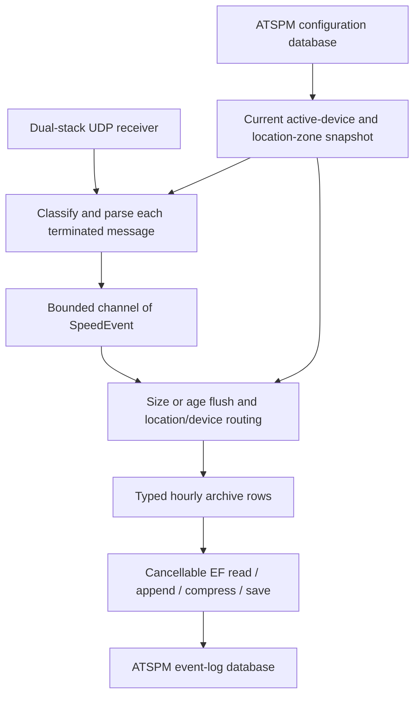

# Speed listener design

Status: implemented; operational release gates remain below. Updated October 15, 2026.

This document describes the current code. The original prototype was ATSPM's
Speed Listener change; Git history retains the earlier migration proposal.
Historical review findings and their corrections are recorded in
[the review resolution](pr-2-review-resolution.md).

## Runtime and ownership

The .NET 9 host provides `listener`, `generate` and the legacy sample `emitter`.
`SpeedListenerBackgroundService` receives UDP traffic, classifies messages and
queues speed events. `SpeedEventBatchProcessor` routes and batches them;
`DatabaseEventPublisher` drives the local archive/save workflow. Publishing goes
directly to the event-log database; there is no HTTP, Kafka or Pub/Sub publish path.

ATSPM Infrastructure 5.3.1 supplies the domain models, EF contexts, compression,
provider packages and registration extensions. The listener uses
`AddAtspmDbContext`, configuration/event-log repository registrations,
`ApplyVolumeConfiguration`, and the ATSPM logging host conventions.
`EventBatchEnvelope`, transport, batching, retry bookkeeping and the cancellable
writer are local. `ArchiveDataEventsWithoutDeduplication` is derived from ATSPM's
`Atspm/Infrastructure/WorkflowSteps/ArchiveDataEvents.cs` and retains its upstream
Apache license header. NuGet binaries, shared models and database schema are unchanged.



## UDP and packet classification

On IPv6-capable systems one dual-stack socket binds `::` and accepts both IPv4
and IPv6. IPv4-mapped endpoints normalize to IPv4. IPv4-only systems bind IPv4
and reject pure IPv6 source mappings during validation. UDP provides no delivery
acknowledgement, retransmission or cross-datagram reassembly.

Tagged prefixed `Z` + five decimal digits + `XS` packets carry MPH/KPH at bytes
8/9 and six detector digits at bytes 10–15. Compact `XS` packets carry those
fields at bytes 2/3 and 4–9. Timestamp suffixes are optional. Messages joined in
one datagram are separated at `~ CR CR`; a valid frame survives a malformed tail.
The legacy 16-byte tagged packet without a terminator remains accepted.

Basic untagged XS requires an explicit source IP/UDP-port mapping in the
`UntaggedSpeedDetectorMappings` object list. The multi-drop prefix is not a
detector identifier. No endpoint mapping increments UnmappedSpeed, not Rejected.
Valid X1 actuation increments Actuation and produces no speed event. Malformed
X1, unsupported Z4 binary and XT track-file data remain rejected. See
[the protocol guide](wavetronix-protocols.md) for layouts and endpoint examples.

## Device mapping

A six-digit numeric detector ID routes by its first four digits. Four ASCII
numeric location digits are a deployment prerequisite, although ATSPM supports
location identifiers up to ten characters. Other identifiers are counted as
invalid mappings; they are never truncated into potentially conflicting locations.
All channels for a location share one selected speed device; the complete detector
ID remains in storage for report filtering. Device names and IPs do not route tagged events.

For each location identifier, exclude deleted versions first. Compare each
candidate's Start to the current wall clock in that candidate's resolved location
zone, then select the latest eligible Start; tied dates select the highest location
ID and count additional tied rows as duplicates. Historical rows are not duplicates.
A deleted version does not tombstone the whole location; an earlier eligible
non-deleted version can become current, matching ATSPM's dated latest-version query.

Select the lowest-ID SpeedSensor whose DeviceStatus is Active on that version.
Unknown, decommissioned, inactive, testing and staging devices are excluded. If
that current version has no active speed device, do not use a historical device.
LoggingEnabled is not an additional listener selection filter. Unknown detector
warnings identify the detector and location prefix; they do not mean parsing failed.

Refresh is demand-driven when the cache expires, default five minutes: startup
loads it and batch routing calls GetMappingsAsync. A successful refresh replaces
an immutable-use dictionary snapshot, including each selected zone. A refresh
failure retains the last successful snapshot and increments a failure counter.
Startup fails if no eligible mapping exists. A later successful refresh may clear
all mappings. Cancellation propagates without a refresh-failure warning.

## Location time zones and timestamps

The ATSPM toolkit's `GetTimeZoneFromCoordinates` derives the zone from each location
version's latitude/longitude, following the downloader approach in the Gilbert
ATSPM checkout. GeoTimeZone is a transitive toolkit dependency, not a direct listener
reference. On Windows, TimeZoneConverter's bundled identifiers map IANA names to
Windows registry zones before `TimeZoneInfo` lookup, including in NLS mode without
ICU IANA support. Windows time-zone updates still supply the conversion rules. Lookups are
cached by coordinate pair within a refresh. ILocationTimeZoneProvider exposes the
same singleton mapping snapshot to the parser: no database or geographic lookup
occurs per packet. A refresh updates both devices and zones.

Missing/nonfinite/out-of-range coordinates or `(0, 0)` use EventTimeZoneId, which
defaults to the server local zone. An unresolved zone also uses that fallback.
A valid coordinate-derived zone takes precedence over the configured fallback,
including an explicit UTC fallback. Warning 3013 reports the fallback count and
zone once per refresh; Debug 3014 identifies each selected location and its zone.
Warning 3015 identifies up to 20 locations per refresh whose derived zone rules
differ from EventTimeZoneId; summary 3016 reports the full count and omitted details.
The comparison uses rules rather than identifier spelling. Differences can be
intentional for multi-zone agencies; inspect coordinates before changing them.
These warnings neither override the resolved zone nor reject events. A wrong but
valid coordinate in the same zone cannot be detected by this comparison.
Unknown/unmapped locations use fallback during parsing and are later counted as unknown.

Receipt times and offset-bearing suffixes are instants converted into the location
zone. Offset-less suffixes are interpreted as wall time in that zone. Ambiguous
fall-back times select the instant closest to receipt and retain their wall-clock
digits; equal occurrences remain separate events. Nonexistent spring-forward
times require an explicit offset. Every stored event timestamp and hourly key has
DateTimeKind.Unspecified, including UTC locations. No zone/offset is persisted.
Changing coordinates or fallback does not migrate earlier records.

## Batching, archive and persistence

The bounded channel defaults to 100,000 events. A full channel rejects the newest
event and counts it as Dropped. A single consumer flushes at BatchSize (5,000)
or FlushInterval (30 seconds since the first event in the batch). The consumer
awaits publication before building the next batch. It emits one envelope per mapped
location/device and counts unmapped events for the current summary period.

The archive path handles SpeedEvent only, partitioning each envelope by calendar
hour. It constructs List<SpeedEvent>, the packaged hourly timeline and
CompressedEventLogs<SpeedEvent> directly, without reflection or dynamic dispatch.
It normalizes location metadata and strips DateTime Kind without shifting wall
clock digits. Assigning Data through CompressedEventLogBase bypasses the typed
accessor's HashSet conversion and preserves every occurrence, including identical
values and repeated references.

The save block creates a scoped IEventLogWriter for each row. It permits eight
concurrent writers by default but serializes writes for the same device within
that workflow. EfEventLogWriter uses packaged context/model/keys/compression,
passing cancellation to FindAsync, AddAsync and SaveChangesAsync. Existing hourly
payloads are decompressed, appended and recompressed; each flush rewrites the
whole affected hourly row. Compression occurs through the packaged EF converter
at persistence, rather than in the archive transform itself.

The workflow composes TPL Dataflow directly rather than inheriting packaged
WorkflowBase so it can retain originating envelopes and logical rows, propagate
completion faults/cancellation, and report committed versus conflicted hours.
The local writer replaces packaged repository Upsert because that write API lacks
cancellation and its union/hash-set merge removes valid equal detections.

ATSPM's current date-range speed/controller report repositories already read
through the base payload accessor and preserve occurrences retained in storage.
Direct callers of a typed compressed row's Data still deduplicate. Standard ATSPM
archive/import/update paths may remove occurrences before a report reads them;
this listener bypasses those write paths. No ATSPM report changes are included here.

## Retry, failure and conflict handling

One PublishAsync operation retains acknowledged envelope/hour keys and logical
row objects. Acknowledged rows are skipped on retry and poison isolation. For an
uncertain acknowledgement, fixed-size before/after fingerprints of persisted
fields, counts and order recognize the intended committed prefix, including later
appends. LocationIdentifier is row metadata and is excluded from event fingerprints.
Fingerprint equality recognizes one write; it does not deduplicate events. Retry
plans retain no extra full-hour payload snapshots, but merging/compression still
materializes hourly data.

Transient provider failures and write-attempt timeouts receive bounded retries
(default three attempts) with capped exponential delay and jitter. WriteTimeout
(default 30 seconds) bounds a complete archive/save attempt, not each row separately.
Provider error codes classify transient, batch-data and fatal failures. Batch-data
failures isolate envelopes; repeated poison drops are tracked per device. At the
default threshold of three, the exception fails the listener after other isolated
envelopes have been attempted. This is not a separate running worker per device.
Schema/model faults and exhausted transient failures propagate to the host.

An unresolvable outside row change raises a scoped write conflict: log Error 3045,
count WriteConflicts/ConflictEvents, and skip only that uncertain device-hour
contribution. It may already have committed. Other hours/devices continue. Good
hours contribute RowsPublished/EventsPublished even when an envelope is partial;
EnvelopesPublished excludes conflicted envelopes. Conflict or poison failure
cannot reset the affected device's consecutive-drop history.

Retry state is in-process only. There is no durable spool or cross-process replay
identity. A crash, shutdown timeout or prolonged outage can lose events. Run only
one writer per sensor stream/device-hour database: read/append/write is not a
cross-process atomic append, and fingerprint recognition does not make multiple
writers safe.

## Configuration, logging and lifecycle

[README configuration](../README.md#configuration) is the authoritative defaults
table. Listener CLI --port overrides its bound port. JSON, environment and ATSPM
volume settings provide database credentials and operational limits; credentials
stay outside source control. Field-specific options validation includes endpoint
indexes, supported zones and cross-field shutdown budget constraints. Generator
discovery eagerly validates options even though it does not start its host.

Npgsql.EnableLegacyTimestampBehavior is enabled before listener/generator database
registration. ATSPM's provider registrations are retained. The packaged library
expects its database context settings; disable migrations for listener-only service
runs. No listener migrations or schema changes are introduced.

Source-generated logs follow ATSPM console/Google/Atspm Windows Event Log hosting.
Normal levels contain lifecycle, refresh, batch and summary records, with bounded
unknown details; Debug retains rejection previews and per-batch routing details.
[The logging guide](logging.md) defines counter semantics and per-sink retention.
PublishLatencyMs is a lifetime mean of recorded completed publication-attempt
work, not per-event or end-to-end latency, and excludes earlier failed attempts
and their retry delays. Late-hour capacity requires recent write timings as well.

Shutdown stops receipt, completes the channel and drains under one shared deadline,
using ShutdownMaxWriteAttempts (default one) for shutdown publishes. Validation
requires more than WriteTimeout times shutdown attempts plus retry-delay budget;
this allows one publish attempt cycle, not a guarantee of draining a full queue.
Host ShutdownTimeout adds five seconds to the drain budget. Timed-out drain logs
queued plus in-flight residue and fails. Windows service/upgrade and Docker stop
budgets must allow graceful drain. [Windows deployment](windows-service.md) and
[generic deployment scripts](../deploy/README.md) describe installation and rollback.

## Verification and remaining gates

As of October 15, 2026, 219 Release C# tests passed on Windows and Linux, and all
21 location-zone tests passed under Windows NLS without ICU IANA lookup. Real loopback tests cover
IPv4/IPv6, and compressed SQLite tests cover duplicate preservation, append,
acknowledgement loss and scoped conflicts. Multi-zone tests cover Utah, New York,
Arizona, DST, joined frames, invalid coordinates and location-version cutoffs.
Windows script tests mock service/firewall operations; CI is configured to run
them under PowerShell 7 and Windows PowerShell 5.1, plus Linux .NET build/tests.
Local success does not assert the current remote CI run is green.

| Relational provider | Model, schema generation and compressed event timestamps | Live insert/append |
| --- | --- | --- |
| PostgreSQL | Passed; timezone-naive timestamp keys | Passed in disposable PostgreSQL 16 |
| SQLite | Passed; TEXT keys | Passed in temporary SQLite |
| SQL Server | Passed; datetime2 keys | Not yet run |
| MySQL | Passed; datetime keys | Not yet run |
| Oracle | Passed; TIMESTAMP keys | Not yet run |

InMemory is also available through ATSPM for development/testing; it is not a
relational production durability check. Full event precision lives in compressed
payloads, independently of hourly-key column precision.

The opt-in [DatabaseProviderSmoke](../tests/DatabaseProviderSmoke/Program.cs)
accepts a new empty disposable database through ATSPM_PROVIDER_SMOKE_CONNECTION
and a provider-name argument. It creates test tables/data and rejects an existing
schema; it does not delete a supplied database. Do not point it at agency databases.

Remaining gates: live SQL Server/MySQL/Oracle probes; at least two hours of paced
expected-peak traffic with growing hourly rows and stored-count reconciliation;
representative hotspot distribution; agency packet/time comparisons; production
soak/rollback and dependency/security review. Earlier
[Docker results](docker-load-test-results.md) are historical short-run evidence,
not validation of the latest build at sustained peak capacity. Monolith cleanup
is a separate change after deployment and consumer dependency review.


To run the opt-in storage probe from the repository root, set the connection
variable through your normal local secrets process, then choose the provider:

```powershell
dotnet run --project tests/DatabaseProviderSmoke -c Release -- PostgreSql
```

Accepted names are PostgreSql, SqlServer, MySql, Oracle and Sqlite. The ordinary
application test suite checks provider models/compression without requiring live
engines; running the probe is a separate integration step.
